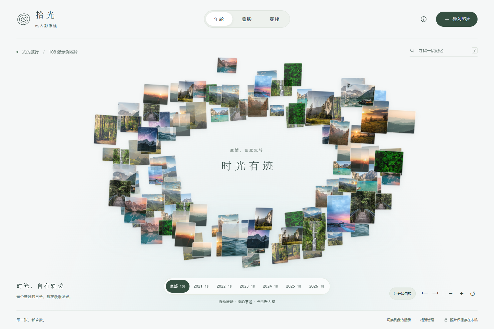

# 拾光 · 空间相册

让照片成为可以走进去的回忆。

[在线体验](https://dallovers.github.io/shiguang/)



## 三种空间视图

- **年轮**：照片组成有纵深的空间年轮，缓慢自转；支持暂停、拖动旋转、惯性减速及滚轮靠近。
- **叠影**：照片连续跟随拖动，松手后自然停靠。可展开、收拢，使用滚轮、方向按钮和进度条翻阅；点击侧面照片聚焦，再次点击看大图。
- **穿梭**：照片以独立坐标散布在整个三维空间，中间也有照片，没有固定轨道。拖动上下左右平移，滚轮前进后退；切换「环顾四周」后拖动转动视角。手机可用移动按钮和前后箭头，电脑还支持 W/S 前后、A/D 左右、Q/E 上下。照片位置固定，可以原路返回，重置按钮回到起点。

支持手机和电脑、键盘操作、减少动态效果设置。切换到后台或查看大图时暂停场景动画。

## 导入自己的照片

点击「导入照片」，在手机相册或电脑中多选照片，也支持拖放和电脑文件夹导入。

- 照片和缩略图通过 IndexedDB 保存在当前浏览器，不上传到服务器。
- 支持名称/日期搜索、年份筛选、重复照片检测，以及照片名称和日期编辑。
- JPEG 优先读取 EXIF 拍摄日期，其他文件以修改日期归类，可手动调整。
- HEIC/HEIF 支持取决于浏览器，不支持时请转换为 JPG/PNG。
- 清除浏览器站点数据会删除本地副本，请保留原始照片。
- 不跨设备同步，分享链接不会分享你的本地照片。更换网站域名后需重新导入照片。

初次打开使用示例风景照片。示例素材来自 Unsplash，18 张照片重复排布为 108 张用于演示空间效果，来源记录于 [assets/sources.json](assets/sources.json)。实际导入的照片不会重复生成。

## 本地运行

无需安装前端依赖，使用任意静态 HTTP 服务器即可：

```sh
python -m http.server 8080
```

浏览器访问 `http://localhost:8080`。持久保存推荐使用 localhost 或 HTTPS。

## 文件结构

- `index.html`：相册界面和对话框。
- `app.js`：照片导入、EXIF 日期、筛选、IndexedDB 与信息编辑。
- `spatial.js`：空间透视、自转、相机推进、拖动惯性和运动插值。
- `style.css` / `spatial.css`：基础布局与空间照片样式。
- `assets/`：示例图片和来源。

GitHub Pages 从 `main` 分支根目录发布；`.nojekyll` 保持静态文件原样部署。没有构建步骤、分析追踪或照片上传服务。
